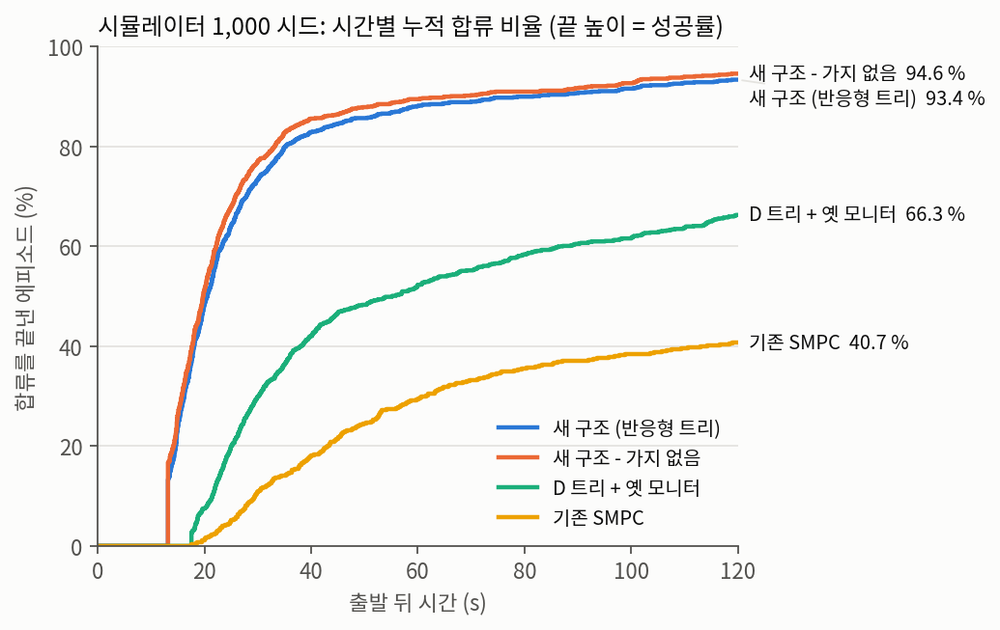
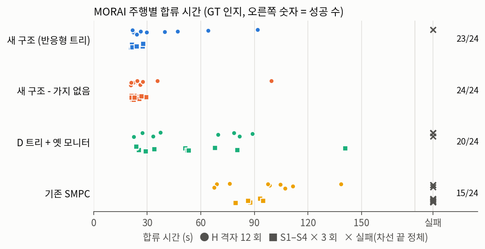

# research/ — 시나리오 트리 SMPC 차선 변경 판단기

기존 SMPC(이 저장소의 `src/`, dd1cf54)는 차선 변경 후의 대응(복귀·제동)을 위험도 평가에 넣지 않고,
확률과 무관한 게이트(모든 mode clearance, 간격·TTC·헤드웨이)를 확률 제약 위에 겹쳐 둔다. 그래서 느리고
촘촘한 합류 구간에서 차선을 바꾸지 못한다. 이 폴더는 그것을 고치는 연구 코드다.

| 단계 | 기간 | 구조 | 상세 |
|---|---|---|---|
| 1차 (D) | 11-03 ~ 11-04 | 트리 판단 + 실행 중 재계획(모니터) + 게이트 정리. 타겟 차량은 열린 루프 예측 | 아래 [1차 구조 D](#1차-구조-d-11-03--11-04-기록) |
| 2차 (최종) | 11-04 ~ 11-06 | 반응형 예측(자차 ACC 폐루프 + 뒤차 양보) + 트리 단독 판단 + 같은 예측을 쓰는 모니터 | [`docs/plan_v2.md`](docs/plan_v2.md) |

모든 C++ 변경은 파라미터로 켠다. 기본값(꺼짐)에서는 기존 동작과 같다. 인지는 GT(`/Object_topic`)만 썼다.

## 최종 구조 (plan_v2)

```
/Object_topic (GT: 위치·속도·가속도)
  ▼
반응형 예측 (자차와 타겟 차량을 함께 굴림, 0.2 s × 40 = 8 s)
  자차: ACC 폐루프 = 앞차 추종·차선 끝 정지·속도 상한 + 미션 속도 회복 + 제어기 응답(τ 0.4 s)
  뒤차: 자차가 목표 차선에 0.2 m 들어오면 0.6 s 뒤 자차를 앞차로 보고 따라감(감속 ≤ 3.5 m/s²)
  앞차: 자기 앞차를 따라감
  가지: 뒤차 {양보, 비양보} × 앞차 {기본, 급제동, 급가속}, 예외 확률 최솟값 0.05
  ▼
트리 판단 (루트 = 지금 바꾸기 / 유지)
  매 스텝 Σ p·r ≤ ε(0.04), 그중 기대 비용 최소
  남는 조건: G1(목표 차선), G2(궤적 생성), 경로 전환 미리보기, 지평선 맞춤(0.55 + 변경 시간 + 1.5 s ≤ 8 s)
  ▼ 차선 변경 시작
실행: 기본 ACC + 경로 (특별한 명령 없음)
  ▼ 20 Hz
모니터: 같은 예측을 매 틱 다시. 계속 쪽에도 가지별 나중 대응을 넣음(규칙 (가)).
  뒤차가 반응 지연이 지나도 감속하지 않으면 비양보 확률 ↑(베이즈 갱신)
  계속 위험 > 2ε 가 2 틱 연속이고 복귀가 더 안전 → 복귀 (0.3 s 끊기면 rear_abort 폴백)
```

뒤차 반응 값은 MORAI 에서 일부러 합류한 31 건에서 쟀다(`results/m7_npc_reaction.json`): 무반응 0/31,
0.3 m 침범 뒤 감속 시작 중앙 0.57 s, 양보가 필요했던 3 건의 최소 가속도 −3.4 ~ −4.2 m/s².

## 결과 1: 시뮬레이터 1,000 시드

같은 시드 2000–2999, GT 인지, 옛 시뮬(경로 전환 지연 0.1 s)로 모든 방법을 같은 조건에서 돌렸다.
실패 = 120 s 로 두고 같은 시드끼리 짝 평균, bootstrap 95 % CI.

| 방법 | 성공 | 충돌 | 이탈 | 시간 초과 | 합류 중앙값 (성공) | 새 구조 대비 짝 평균 [95 % CI] |
|---|---|---|---|---|---|---|
| 기존 SMPC (dd1cf54) | 40.7 % | 0.8 % | 5.9 % | 52.6 % | 43.5 s | +59.2 s [+56.4, +62.0] |
| D 트리 + 옛 모니터 + 게이트 정리 | 66.3 % | 0.4 % | 0.7 % | 32.6 % | 32.3 s | +36.8 s [+34.0, +39.5] |
| **새 구조 (반응형 트리, 모니터 (가) 2ε)** | **93.4 %** | **0.3 %** | 2.3 % | 4.0 % | **19.6 s** | — |
| 새 구조, 복귀 문턱 5ε | 93.7 % | 0.5 % | 2.2 % | 3.6 % | 19.2 s | −1.0 s [−1.7, −0.4] |
| 새 구조, 옛 모니터 규칙 | 93.7 % | 0.3 % | 2.0 % | 4.0 % | 19.7 s | +0.1 s [−0.5, +0.6] |
| 새 구조 - 가지 없음 (기본 예측 하나) | 94.6 % | 0.3 % | 2.0 % | 3.1 % | 19.3 s | −1.9 s [−2.8, −1.1] |

- 기존 SMPC 실패의 대부분은 차선 끝 정체(시간 초과 52.6 %)다. 새 구조는 이것을 4.0 % 로 줄였다.
- 새 구조 충돌 3 건은 모두 **차선 유지 중 앞차 추돌**이고, 자차 차선 변경 중 충돌은 0 이다.
  - 2004·2800: 합류 직후 추돌. 옛 시뮬은 경로 전환이 0.1 s 뒤인데 MORAI·예측은 0.55 s 다. 0.55 s 로 고친 시뮬에서는 사라진다.
  - 2989: 정지 대기열에서 0.2 m/s 로 앞차에 닿음. 기존 SMPC 도 같은 시드에서 충돌한다.
- 복귀 문턱 5ε 는 1.0 s 빠르지만 충돌이 2 건 늘어(2674, 2922) 2ε 를 유지했다.



표: `python3 analysis/sim_n1000_table.py` → `results/final/table_n1000.json`, 그림: `python3 analysis/plot_results.py`.

## 결과 2: MORAI (GT 인지)

같은 시나리오 묶음, 실패 = 180 s. 접촉 = MORAI 충돌 이벤트(괄호 = 자차 차선 변경 중).

**H 격자: NPC 생성 속도 {30, 50, 70} → NPC 목표 속도 {40, 60, 80, 100} km/h, 12 개 × 1 회**

| 방법 | 주행 | 성공 | 합류 중앙값 | 접촉 | 복귀 | 차선 끝 정지 | NPC 목표 40·60 km/h (느린 교통, 정지 출발) |
|---|---|---|---|---|---|---|---|
| 기존 SMPC | v4 (11-04) | 9/12 | 105.9 s | 0 (0) | 0 | 21 | 3/6 |
| D | v4 (11-04) | 8/12 | 80.0 s | 0 (0) | 36 | 26 | 3/6 |
| **새 구조** | v11 (11-06) | **11/12** | **27.9 s** | 1 (0) | 12 | 9 | **6/6** |
| 새 구조 - 가지 없음 | v11 (11-06) | 12/12 | 22.9 s | 0 (0) | 6 | 2 | 6/6 |

**S1–S4 × 3 회** (NPC 생성 → 목표 속도 km/h: S1 보통 70 → 70, S2 뒤차 가속 54 → 90, S3 감속 교통 72 → 43, S4 느린 교통 72 → 29)

| 방법 | 주행 | 성공 | 합류 중앙값 | 접촉 | 복귀 | 차선 끝 정지 |
|---|---|---|---|---|---|---|
| 기존 SMPC | v2 (11-04) | 6/12 | 137.4 s | 2 (0) | 4 | 19 |
| D | v3 (11-04) | 12/12 | 42.6 s | 1 (0) | 40 | 28 |
| **새 구조** | v11 (11-06) | **12/12** | **21.7 s** | 0 (0) | 2 | 0 |
| 새 구조 - 가지 없음 | v11 (11-06) | 12/12 | 23.0 s | 0 (0) | 2 | 0 |

- 합계 24 회 성공: 기존 15, D 20, 새 구조 23, 가지 없음 24. 모든 방법에서 자차 차선 변경 중 MORAI 접촉은 0 이다.
- 새 구조 접촉 1 건(H_s70_d80): 차선 유지 중 옆 NPC 가 약 80° 로 꺾어 앞부분이 자차 경로로 들어왔다.
- 새 구조 실패 1 건(H_s30_d100): 차선 3 이 막혀 차선 2 끝에 갇혔다. 승인 → 복귀가 5 번, 매번 뒤에 있던 차선 2 차가 차선 3 으로 끼어들었다.
- 계산 시간(v11, C++): 트리 판단 p50 15.6 / p90 35 / p99 51 / 최대 71 ms, 가지 없음 p99 10 ms,
  차선 변경 중 모니터 주기 p99 91 ms. 1차 D 의 p99 134 ms 보다 짧다.
- 예측 수정 전(v9)과 짝: 새 구조 중앙 −0.7 s(빠름 12 / 느림 10), 가지 없음 −4.6 s. bag 장면 918 틱을 C++ 판단에 다시 넣으면
  수정이 바꾼 판단은 2.0 % 다. v9 ↔ v11 차이는 대부분 주행마다 다른 교통 때문이다.
- v5 → v11 사이 고친 버그 8 가지(투영, 앞차 누락, 미리보기 없는 승인, 연결 경로 모드 등)는 `docs/plan_v2.md` 진행 기록에 있다.



표: `python3 analysis/morai_step7.py` → `results/morai_step7.json`, v9 짝: `python3 analysis/morai_v11_vs_v9.py`.

주행 영상(11-06, 새 구조 8 회 + 기존 SMPC 2 회, 자막 = 방법·시나리오·속도·차선 변경 이벤트): https://claude.ai/artifact/2tVAzjj2Mo2TWC784ssUi6
(`morai/record_videos.py` 로 녹화, `morai/make_video.py` 로 자막, 기록 `results/morai_videos_1106.jsonl`).

## 무엇이 효과를 냈나

- **대부분은 반응형 예측이다.** 시뮬 200 시드에서 D 대비 −38.6 s [−44.9, −32.5]. 그중 G6–G8 제거 몫이 약 14 s
  (G6–G8 을 남긴 변형 +13.8 s). 정지 출발에서 합류 뒤 자차 속도를 11 km/h 로 보던 예측(실제 4 s 26 km/h)이 고쳐진 것이 크다.
- **트리 예외 가지의 안전 이득은 측정되지 않았다.** 가지는 판단을 더 조심스럽게 만들지만(1,000 시드 약 1.9 s 느림),
  충돌은 가지 없음과 같다(3 / 3). MORAI 도 23/24 vs 24/24. 남은 충돌은 가지가 다루지 않는 사건(합류 직후 추돌,
  옆 차선 NPC, 앞차의 긴 감속)이다.
- **안전은 모니터에서 나온다.** 1차 2×2 에서 확인했고(아래), 새 구조에서도 자차 차선 변경 중 충돌은 0 이다.
  모니터 규칙 (가)와 옛 규칙은 결과가 같다(+0.1 s, 충돌 같음). (가)는 계속 위험을 승인과 같은 식(가지별 나중 대응)으로
  계산해 승인–모니터가 일관된다(v8 bag 재생: 복귀 10 건은 같고, 최대 계속 위험 ≥ 0.05 인 차선 변경 30 → 16 %).

## 민감도

| 변형 | 조건 | 결과 | 판단 |
|---|---|---|---|
| 예외 최솟값 0.1 / 0.2 (기본 0.05) | 옛 시뮬 200 시드, 11-04 코드 | +3.8 s, 충돌 2 / +10.5 s, 충돌 1 | 0.05 유지 |
| 모니터 문턱 3ε / 5ε (기본 2ε) | 같음 | −0.6 s / −2.6 s, 충돌 0 | 1,000 시드에서 5ε 충돌 +2 → 2ε 유지 |
| 예측 수정 2 가지 (지나친 앞차 = 뒤차, ACC 합류 하한) | 고친 시뮬 200 시드 | 성공 93.5 → 93.0 %, 둘 다 성공한 시드 −0.8 s [−1.8, −0.1], 시드 2009 충돌 생김 | MORAI 판단 2 % 변화. 옵션으로 둠(기본 꺼짐) |
| 지평선 7.4 s / 6.8 s (기본 8 s) | 고친 시뮬 200 시드, 예측 수정 켬 | 성공 93.0 → 95.0 / 95.0 %, 충돌 1 → 0 / 0. 둘 다 성공한 시드 −0.35 s [−1.14, +0.27] / −0.57 s [−1.31, −0.07], 실패 = 120 s 로 세면 −2.2 / −2.8 s | 유망, 미채택: 1,000 시드 확인과 C++ 지평선 파라미터 필요 |
| 지평선 12 s / 12 s + 간격 후보 | 고친 시뮬 200 시드 | +4.4 s [+1.3, +7.5] / +3.5 s [+0.5, +6.6] (8 s 대비), 계산 약 2.2 배 | 미채택 (브랜치 `research/gap-candidates`) |
| 앞차 없는 차 가속도 감쇠 2.5 s (기본 1.5 s) | 고친 시뮬 200 시드 | 성공 92.0 %, 둘 다 성공한 시드 +0.30 s [−0.15, +0.97], 시드 2009 그대로 | 미채택. MORAI GT 맞춤 값은 감속 2.0–2.5 s, 가속 3.5–4.0 s |

'고친 시뮬' = 경로 전환 지연 0.55 s(`switch_delay_sec`) + C++ 과 같은 ACC 합류 하한(`acc_floor_real`). 결과 파일 `results/final/pred2_d055fr_*`.
첫 두 줄의 합류 시간 차이는 실패 = 120 s 짝 평균이다. 아래 줄은 성공이 바뀐 시드가 평균을 좌우해, 둘 다 성공한 시드끼리의 차이를 함께 적었다.

## 한계

**안전**
1. **앞차의 긴 감속 (시드 2009, 고친 시뮬의 유일한 충돌, 자차 차선 변경 중)**: 앞에 차가 없는 목표 차선 앞차가 −1.6 m/s² 로
   4 s 감속했다. 예측은 앞차 급제동 가지를 고정 5 % 로 두고 관측으로 갱신하지 않는다(뒤차 비양보는 갱신한다). 차선 변경 중
   자차 ACC 는 목표 차선 앞차를 1.5 m/s² 까지만 따라가므로 거리가 좁혀진다. 예측 수정(ACC 하한)을 켜면 승인 시점이 바뀌어 드러난다.
   고칠 후보(미적용): 계속 감속하는 앞차의 급제동 확률을 올리는 사후 갱신, 또는 감속이 오래 가는 모델.
2. **모델에 없는 사건**: 옆 차선 끝 NPC 의 끼어듦·측면 합류(타겟 차량의 차선 변경), 출발 차선 뒤차, 비스듬히 들어오는 옆 차선 NPC
   (MORAI v11 접촉 1 건, H_s30_d100 실패).
3. **표본 크기**: 시뮬 충돌 0.3 % 는 1,000 시드 중 3 건이라 CI 가 넓다. MORAI 는 방법당 24 회, 주행마다 교통이 달라 방법 간
   차이를 통계적으로 가르기 어렵다.

**예측 모델**

4. **σ(t) 미보정**: 위험도의 σ_long = 0.60 + 0.55t, σ_lat = 0.25 + 0.10t 는 원래 SMPC 에서 물려받은 값(2026-09-04 bag 에 맞춤,
   스크립트 없음)이다. 반응형 예측에 맞춰 다시 확인하지 않았다.
5. **자차 예측 오차**: MORAI 승인 뒤 속도 오차 평균 0.6–1.6 m/s. 고속에서 가속을 과대 예측하고(약 1.5 vs 0.3 m/s²),
   앞차가 있는 차는 측정 가속도를 쓰지 않는다. 정지 출발 응답(a_max × τ 격자, 103 건)은 RMSE 1.0–1.2 로 더 나아지지 않아,
   H_s30_d80 처럼 위험이 2ε 근처에서 흔들리며 복귀하는 경우가 남는다.
6. **예외 확률은 데이터로 정한 값이 아니다**: 최솟값 0.05 는 정책 값이다. 측정한 뒤차 무반응은 0/31 이다.
7. **양보 후보가 좁다**: 나란히 있는 차 뒤로 빠질 만큼 감속하는 후보가 없어(−0.8 m/s² × 1.2 s) 정체가 생긴다(MORAI v7 H_s30_d60).

**구조**

8. **다음 차선 변경을 보지 않는다**: 이탈 2.3 %(23 건)는 1→2 변경이 차선 2 끝 약 2 m 앞에서 약 18 m/s 로 끝나 2→3 을 못 한
   경우다(차선 1·2 끝 간격 14 m). 지평선을 늘려도 보이지 않는다.
9. **지평선 하한 6.8 s**: 변경을 허용하려면 0.55 + 변경 시간(3.94–4.49 s) + 1.5 s 가 지평선 안에 들어가야 한다. 더 줄이면 지평선 너머
   안전을 학습 같은 다른 수단이 맡아야 한다.
10. **판단으로 풀 수 없는 몫**: 1,000 시드 실패 66 건 중 34 건은 모든 방법이 실패한다(빈틈이 없는 교통).

**평가**

11. **GT 인지만**: LiDAR 수준 인지에서 1차 D 는 기존보다 +8.9 s 느렸다(뒤차 검출 깜빡임 → 복귀 2.44 회/에피소드). 새 구조는
    LiDAR 로 시험하지 않았다.
12. **시뮬 ↔ MORAI 차이**: 옛 시뮬은 경로 전환 0.1 s(MORAI 0.55 s)였고 ACC 합류 하한 규칙이 C++ 과 달랐다. 최종 1,000 시드 표는
    같은 조건 비교를 위해 옛 시뮬 그대로 두었고, 고친 시뮬은 11-06 비교에만 썼다.
13. **MORAI 비교 조건**: 기존·D 는 11-04, 새 구조는 11-06 주행이다. 비교군 D 에는 알려진 투영 버그(treeRootFrenet·treeMonitorReturn
    이 차선 끝 뒤 400 m 연장선에 투영)를 그대로 두었다. MORAI NPC 는 스크립트 차량이라 실제 운전자 반응과 다를 수 있다.

## 구성

| 경로 | 내용 |
|---|---|
| `docs/plan_v2.md` | 2차 구조 계획·완료 기준·진행 기록 |
| `docs/baseline_spec.md` | 기존 SMPC 판단 사양 (파이썬 이식의 근거) |
| `docs/review_20261104.md` | 1차 독립 코드 리뷰 16 건 |
| `sim/smpc_sim/` | 1 차원 Frenet 시뮬레이터, 기존 SMPC 이식, 1차 트리(`tree.py`), 반응형 예측(`reactive.py`), 반응형 트리(`tree_reactive.py`), RL(`rl/`) |
| `sim/tests/` | 파이썬 ↔ C++ 수치 비교 (위험도, 트리, 실행 중 재계획, 반응형 예측 `test_reactive_vs_cpp.py`) |
| `cpp_check/` | 원본 노드 소스를 include 하는 하네스: `rx_harness`(일치 시험), `rx_replay`(MORAI bag 틱을 C++ 판단에 다시 넣음) |
| `analysis/` | MORAI bag 측정(M1–M7), GT 인지 검증, 최종 표(`sim_n1000_table.py`, `morai_step7.py`, `morai_v11_vs_v9.py`, 1차 `sim_final_table.py`·`morai_final.py`), C++ 재생(`rx_replay_ticks.py`, `rx_replay_ab.sh`) |
| `morai/` | MORAI 자동화, 시나리오 S1–S4 + H 격자 12 개, 주행 행렬(`run_matrix.py`, 단계 B·C·H·V·W·P·Q 등) |
| `results/final/` | 시뮬 결과 json (`sim_*_n1000` 최종 표, `pred2_d055fr_*` 고친 시뮬 비교, 1차 `sim_*_n200`) |
| `results/` | MORAI 기록(`morai_runs.jsonl`, `morai_step7.json`), NPC 반응(`m7_npc_reaction.json`), 자차 응답(`m6_ego_response.json`) |

C++ 쪽 변경(모두 기본 꺼짐, 끄면 기존 동작과 같다):
- `smpc_decision_node`
  - 1차: `tree_planner_enabled`, `tree_keep_gates`, `tree_monitor_enabled`, `tree_executable_responses_only`(true), `tree_plant_return`(true),
    `/smpc/tree_abort`, `/smpc/tree_debug`
  - 2차: `reactive_tree_enabled`, `reactive_single`(가지 없음 비교군), `reactive_drop_common`, `reactive/*`(`config/reactive_morai.yaml`:
    자차 응답·미션 속도 회복·뒤차 반응), `reactive/monitor_tree`(모니터 (가), true), `reactive/passed_front_as_rear`·`reactive/merge_floor`
    (예측 수정, false), `reactive/accel_decay_s`(1.5), `tree_abort_risk_factor`(복귀 문턱 배수, 2.0)
- `lane_change_supervisor_node`: `tree_abort_enabled`, `tree_abort_confirm_count`(2), `tree_abort_heartbeat_timeout_sec`(0.3)
- `target_selector_node`: GT 경로 보정(`object_topic_ref_to_center_m`, heading 오프셋, 중복 프레임 제거, 자차 외삽)

## 실행

```bash
cd research
HARNESS=rx_harness cpp_check/build.sh && python3 sim/tests/test_reactive_vs_cpp.py   # C++ 일치 확인
python3 sim/run_batch.py --planner rx_mt --n 1000 --seed0 2000 --workers 8          # 새 구조
python3 sim/run_batch.py --planner rx_single --n 1000 --seed0 2000 --workers 8      # 가지 없음
#   플래너 접미사: _m5(복귀 문턱 5ε) _mo(옛 모니터) _fNN(예외 최솟값 0.NN) _pf _fl(예측 수정) _hNN(지평선 NN 스텝) _adNN(감쇠 NN/10 s)
#   고친 시뮬: --cfg '{"switch_delay_sec": 0.55, "acc_floor_real": true}'
python3 analysis/sim_n1000_table.py

# MORAI (GT 인지, 집 PC sim_ip 192.168.100.10)
roslaunch smpc_lane_change research_morai.launch method:=tree tree_keep_gates:=false reactive:=true \
    reactive_passed_front_as_rear:=true reactive_merge_floor:=true            # 새 구조 (v11)
#   가지 없음: + reactive_single:=true
cd morai && python3 run_matrix.py --phase P --prefix v11_ && python3 run_matrix.py --phase Q --prefix v11_
python3 ../analysis/morai_step7.py
```

---

## 1차 구조 D (11-03 ~ 11-04, 기록)

1. **트리 판단**: mode 가 드러나기 전에는 공통 행동을 하고, 드러난 뒤에는 가지별 대응(계속·복귀·제동,
   실행 계층이 실제로 하는 것만)을 고른다. 스텝별 Σ_j p_j r_j ≤ ε 를 지키는 대응 조합을 열거해 기대 비용이
   가장 낮은 루트를 고른다.
2. **실행 중 재계획(모니터)**: 차선 변경 중 매 틱 "계속" 과 "복귀" 두 루트를 같은 트리로 풀어(2ε) `rear_abort`
   를 대체한다. supervisor 는 연속 2 회일 때 복귀하고, 트리 메시지가 0.3 s 끊기면 rear_abort 로 돌아간다.
3. **게이트 정리**: G3(지금 간격·TTC), G5(예측 간격·TTC), 모든-mode clearance 를 걷어낸다.
   G1/G2/G6/G7/G8 과 정상 가지 clearance, 예측 실패 시 fail-closed 는 남긴다.
4. **RL 가치함수**: 트리 잎(8 s 뒤)을 학습한 V 로 평가한다 (`sim/smpc_sim/rl/README.md`). 시뮬레이터에만 있고,
   최종 로직으로 다시 학습해도 V 없는 제안보다 빠르지 않았다(+1.7 s [−2.2, +5.4]).

보고서: Claude Docs "시나리오 트리 SMPC — 고속 연속 합류 판단의 보수성 줄이기".

### 핵심 결과 (시뮬레이터 env3, 같은 시드 2000–2199, GT 인지)

| 방법 | 판단 | 실행 | 성공 | 충돌 (자차 차선 변경 중) | 합류 중앙값 | 기존 대비 합류 시간 [95 % CI] |
|---|---|---|---|---|---|---|
| 기존 SMPC (dd1cf54) | 기존 | rear_abort | 42.0 % | 0.5 % (0) | 49.1 s | — |
| A. 게이트만 정리 | 기존 | rear_abort | 64.0 % | 9.0 % (11) | 32.6 s | −22.6 s [−29.4, −15.9] |
| B. 기존 판단 + 트리 모니터 | 기존 | 모니터 | 67.0 % | 2.0 % (0) | 32.1 s | |
| C. 트리 판단 + rear_abort | 트리 | rear_abort | 65.0 % | 10.5 % (15) | 32.3 s | |
| **D. 제안 (트리 + 모니터)** | 트리 | 모니터 | **66.0 %** | **1.5 % (0)** | **34.0 s** | **−20.8 s [−27.4, −14.0]** |

- **속도는 게이트 정리에서, 안전은 실행 중 재계획에서 나온다.** 게이트만 걷어내도 합류는 빨라지지만(A) 자차 차선
  변경 중 충돌이 생긴다. 모니터는 판단 방식과 무관하게 그 충돌을 0 으로 만든다(충돌 −7 / −9 %p). 같은 실행에서
  판단만 트리로 바꾸면 합류 시간 +0.9 s [−1.7, +3.7], 충돌 −0.5 %p 로 차이를 보이지 않는다(CI 폭 ±3–4 s).
- 남은 충돌(모든 방법)은 차선 끝 NPC 가 TTC 1 s 만 보고 끼어들거나 합류 도중 두 차선에 걸쳐 멈춘 경우다.
- 실행 안 되는 대응(계속+가속, 복귀+감속)을 허용하면 4.2 s [−6.8, −1.7] 더 빨라 보인다. 제안은 이것을 뺀 값이다.
- 게이트를 유지한 트리는 기존과 같다(41.5 %, 44.1 s): 병목은 게이트다.
- 판단 트리가 효과가 없던 이유: 뒤차 가속 확률(GT 표)이 평소 0.006–0.007 ≪ ε 0.04 라 열린 루프와 같은 판단(일치 96 %).
  이것이 2차 구조(반응형 예측)로 간 이유다.

표 전체: `python3 analysis/sim_final_table.py`, 충돌 분류: `python3 analysis/sim_collisions.py <planner…>`.

| 변형 | 비교 | 합류 시간 차이 [95 % CI] | 비고 |
|---|---|---|---|
| NPC 반응 약화 (침범 1.0 m, 최대 제동 4 m/s²) | 제안 − 기존 | −21.1 s [−27.7, −14.3] | 판단 효과(D − B) +0.7 s [−2.4, +3.9], 자차 변경 중 충돌 A 11 → B·D 0 |
| RL 잎 V_w (최종 로직 재학습, `results/value_final_w/`) | V 있음 − 제안 | +1.7 s [−2.2, +5.4] | 성공 65.5 %, 충돌 1.0 % |
| ε = 0.02 / 0.08 | − 제안 | +4.1 s [+1.3, +7.1] / −6.2 s [−9.4, −3.4] | 0.08 에서 2-D 분리 거리 p05 1.12 → 0.90 m |
| LiDAR 수준 인지 | 제안 − 기존 (둘 다 LiDAR) | +8.9 s [+3.9, +14.1] | 뒤차 검출 깜빡임 → 복귀 2.44 회/에피소드, 이탈 17.5 % |
| MORAI 속도 조합 16개 × 시드 50개 | 제안 − 기존 | 목표 ≥ 60 km/h 11개 중 9개 유의하게 빠름 | 목표 ≤ 43 km/h 5개는 차이 없음 (`analysis/sim_scenarios_table.py`) |

### MORAI 결과 (GT 인지, D vs 기존)

| 묶음 | 쌍 | 성공 (기존 / 제안) | 제안이 빠른 쌍 | 합류 시간 차이 중앙값 (실패 = 180 s) |
|---|---|---|---|---|
| S1–S4 × 3 회 | 12 | 6 / 12 | 12 / 12 | −69.9 s |
| 속도 격자 {30,50,70} → {40,60,80,100} km/h × 2 회 | 24 | 20 / 23 | 20 / 24 | −54.8 s |
| 전체 | 36 | 26 / 35 | 32 / 36 | −57.2 s |

- 기존은 S3·S4(NPC 목표 속도 43·29 km/h)와 격자 50→40·70→40 에서 모두 차선 끝 정체로 끝났다. S3·S4 에서 목표 차선이 옆일 때
  바꾸기를 원한 틱의 99.8 % 가 G3–G5 중 하나 이상에 막혔다(`analysis/morai_reject_reasons.py`).
- D 의 실패 1 건(격자 30→100 1 회차)은 모니터 복귀 뒤 차선 0 끝에서 끼어들기 인터록(G7, `cutin_safe=0`)에 막힌 정체다.
- 계산 시간(D): 트리 판단 p50 5.5 / p90 68 / p99 134 ms, 차선 변경 중 모니터 주기 p50 50 ms / p99 0.14 s.
- 정지 출발(H 격자 1 회, v4)에서는 D 도 8/12 로 기존(9/12)보다 낫지 않았다: 합류 뒤 자차 속도 과소 예측과 승인 직후 복귀.

표: `python3 analysis/morai_final.py` (기존 `v2_B_*`·`v3_C_*`, 제안 `v3_*`, 기록 `results/morai_runs.jsonl`).
거짓 완료로 무효 처리한 주행은 `results/morai_runs_invalid.jsonl` 로 옮기고 다시 돌렸다(`morai/rerun_invalid.sh`).
